<div align="center">




</div>

> 🍴 Forked from [estevaofon/angry-birds-python](https://github.com/estevaofon/angry-birds-python). I use this project to study **game loops, 2D physics and object-oriented design in Python**. All credit for the original game goes to its author.

## 🎮 Controls

| Key | Action |
|:--|:--|
| Mouse drag | Aim and launch the bird |
| `S` | Zero-gravity mode |
| `N` | Back to normal gravity |
| `W` | Toggle walls |

## 🚀 Run It

```bash
git clone https://github.com/Hamnakhan123/angry-birds-python.git
cd angry-birds-python
pip install -r requirements.txt
cd src && python main.py
```

<details>
<summary><b>📜 Original README</b></summary>

Angry Birds in Python
=====================
[Youtube Video](https://www.youtube.com/watch?v=B7G5JtCFepE&feature=youtu.be)


Requirements
------------
```bash
pip install -r requirements.txt
```

To play
-------
1. Clone the project.
2. Open the src folder.
3. `python main.py`

Zero Gravity
------------

* To activate the "zero gravity mode" press key s.
* To back to normal mode press key n.

Activate &  Deactivate the wall
-------------------------------

* To activate or deactivate the wall press key w.

Join the project
----------------
The project is Open Source. Feel free to contribute.
Please help me to keep this project updated! Thanks you very much :)

</details>

---

<div align="center">

**Built by [Hamna Zahid Khan](https://github.com/Hamnakhan123)** · Software Engineer · Lecturer · Web Developer · Event Organizer

[](https://hamnakhan123.github.io/Hamna_Portfolio/)
[](mailto:hamnazahidkhan@gmail.com)
[](https://github.com/Hamnakhan123)

</div>
